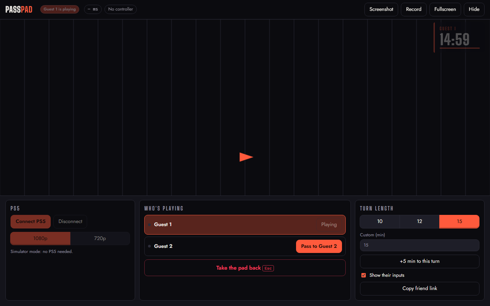

# PassPad

**Pass the pad.** Share one PS5 with up to four friends from a browser, over a private
[Tailscale](https://tailscale.com) link. The person with the PS5 stays in charge: they see
everything, hand the controller over for timed turns, and take it back instantly.

Built for two people (one with the PS5, one somewhere else in the world) and works the same for a
small group of 3–5.



## How it works

```
 PS5 ──LAN── host laptop ─────────── Tailscale (encrypted, private) ─────────── friend's laptop
            chiaki-ng   (Remote Play: receives the PS5 picture, presses the buttons)
            MediaMTX    (passes the picture on, no re-encoding: low CPU)      Firefox + any USB/
            PassPad     (web page, who-has-control, turn timer)               Bluetooth controller
```

- The host laptop runs a patched [chiaki-ng](https://github.com/streetpea/chiaki-ng) (Sony Remote
  Play), [MediaMTX](https://github.com/bluenviron/mediamtx) and a small Bun server. It does not
  re-encode the video, so any ordinary laptop works.
- Everyone opens the same page. The host sees the controls; friends see the stream and a big
  **Ask for the pad** button.
- **Locked by default**: friends' controllers do nothing until the host clicks **Pass to …**.
  Each turn has a countdown (10/12/15 minutes or any length); the pad returns automatically when it
  ends, when the friend's connection drops, or immediately on **Take the pad back** (or `Esc`), which
  first releases every button so the car doesn't keep driving.
- Quality is **1080p60**. If 1080p doesn't produce a picture within about 25 seconds, PassPad
  switches to **720p** by itself, and the host can also switch manually.
- Only addresses on your Tailscale network that you added can open the page. Everyone else gets
  "Forbidden", and nothing is opened to the internet.

## Get started

- **The person with the PS5:** follow [SETUP-GUIDE.md](SETUP-GUIDE.md). In short, download
  `passpad-windows.zip` from Releases, unzip it, double-click **START-PassPad.cmd** and answer the
  questions.
- **Friends:** install Tailscale and accept the host's invite, then double-click
  **JOIN-PassPad.cmd** (or open `http://<host's Tailscale address>:3000` in Firefox). Plug in a
  controller and press a button.

| Extra                         | How                                         |
| ----------------------------- | ------------------------------------------- |
| Check that everything is fine | `START-PassPad.cmd doctor`                  |
| Change friends / PS5 address  | `START-PassPad.cmd setup`                   |
| Update PassPad                | `START-PassPad.cmd update`                  |
| Start with Windows            | `START-PassPad.cmd autostart` (again = off) |

On the page: **Screenshot** saves a PNG and **Record** saves a WebM clip (press again to stop). Any
controller works; XInput pads without a touchpad use **Back+Y**, **L3+R3** or the **Tab** key for
the touchpad. Friends can change the stick dead zone in their settings.

When something goes wrong, a panel offers **Copy details** and **Report on GitHub** (a pre-filled
issue on this repo). Logs are kept on the host in `logs/` with passwords removed: `passpad.log`
for the server and chiaki-ng, `starter.log` for START-PassPad.cmd.

## Development

```sh
bun install
bun start          # simulated console at http://localhost:3000, no PS5 needed
bun run check      # typecheck, lint, format, tests
```

Settings: [docs/configuration.md](docs/configuration.md). Security model:
[docs/security.md](docs/security.md). WebSocket messages: [docs/protocol.md](docs/protocol.md).
Releases are built by `.github/workflows/release-windows.yml` when you push a `v*` tag.

## Credits

PassPad is a fork of [PlayGTA](https://github.com/germanfndez/playgta) by
[@germanfndez](https://github.com/germanfndez), who built the original project: the chiaki-ng
network-input and stream-out patches, the WebRTC video path, the input codec and much of the
server underneath this. PassPad turns it into a private version for a few friends. Thank you!

## License

MIT, except `chiaki/` (patches to chiaki-ng, AGPL-3.0; see `chiaki/NOTICE`). Fonts: SIL OFL
(`public/fonts/`). Not affiliated with Sony. PlayStation and PS5 are trademarks of Sony
Interactive Entertainment.
